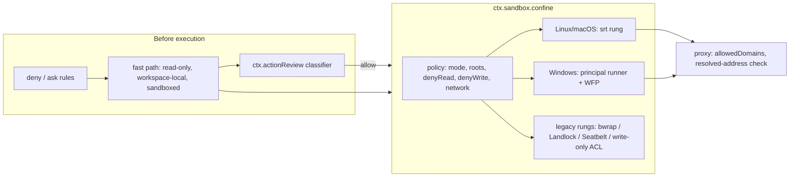

# Tidebloom Sandbox v2: Claude Code's sandbox and auto mode, adapted for DSH

## Context

The adopted v1 (`TIDEBLOOM_SANDBOX_TIDEBLOOM_PLAN.md`) gives Tidebloom approval-free module extensions. Each call runs in a fresh confined Node process with an empty environment and no harness tools; writes are limited by `write: none | data | workspace`.

It already matches these Claude Code practices: auto-allow inside the sandbox, no unsandboxed retry (strict mode), fail closed when confinement cannot start (`failIfUnavailable`), environment scrubbing, and policy that a workspace cannot widen.

Remaining gaps, which this plan closes:

| Claude Code practice | Source | DSH today |
|---|---|---|
| Network denied by default; a host proxy enforces `allowedDomains` | srt README "Dual Isolation Model" | Open network for every confined process |
| `credentials` and `denyRead` | Claude Code sandboxing, "Protect credentials" | Every read allowed, including `~/.dsh/.credentials.yaml` |
| Mandatory deny paths inside writable roots (`.git/hooks`, `.git/config`, shell rc files, `.vscode/`, `.mcp.json`, …) | srt "Mandatory Deny Paths" | `write: workspace` can plant a git hook that later runs unsandboxed |
| Auto mode: deny/ask rules, then fast paths, then a classifier; `hard_deny`/`soft_deny`/`allow`/user-intent tiers; config never read from the repo; repeated-block fallback | Claude Code permission modes and auto-mode config | `dsh-experimental-auto-review`: an experimental, opt-in layer whose allowed calls run with **Full access** |

User decisions recorded on 2026-11-07:
- Adopt all four layers: credential read protection, protected write paths, network deny-by-default with declared hosts, and an auto-mode classifier gate.
- Auto mode is a DSH-wide permission mode, available in every agent preset, not only Tidebloom.
- Adopt `@anthropic-ai/sandbox-runtime` (srt). Follow srt's design for Windows by extending DSH's Windows implementation.

### Correction to a premise: srt has a Windows backend

srt 0.0.81 (Apache-2.0, Node ≥ 22.12, ESM, deps `zod`, `commander`, `node-forge`, `@pondwader/socks5-server`) ships **Windows (alpha)** through a bundled Rust helper, `srt-win.exe`, for x64 and arm64. *Claude Code* runs unsandboxed on native Windows, but the library itself does not lack a Windows backend. The srt-win model:
- **Setup:** a one-time elevated `windows-install` (one UAC prompt) creates a dedicated `srt-sandbox` local account and a `sandbox-runtime-users` group, with a DPAPI-encrypted password in HKLM.
- **Network:** a machine-wide WFP filter set at `ALE_AUTH_CONNECT_V4/V6` permits loopback to the proxy port range (default 60080–60089) and blocks every other connect made under the sandbox SID.
- **Launch:** a two-hop launch (`CreateProcessWithLogonW`, then a write-restricted token inside a job object).
- **Files:** additive inheriting ACEs (ALLOW for `allowWrite`/`allowRead`; DENY for `denyRead`/`denyWrite`, plus a `FILE_DELETE_CHILD` deny on the parent). Credential stores are excluded from a profile read grant.
- **Documented limits:** Schannel/WinHTTP clients cannot do TLS under the restricted token. DNS goes through `Dnscache`. The fence misses an anonymous-token or derived-token socket. SMB is carried by the kernel redirector. Account and group are machine-wide, which matters on shared machines.

Workstream C therefore starts with a decision gate: wire srt-win as the Windows backend, or build a DSH-owned implementation of the same model. The user's direction (extend DSH's Windows implementation) is the default; the gate exists because srt-win already contains most of that work.

## Principles adopted

1. **Dual isolation.** File isolation without network isolation still allows exfiltration, and the reverse also holds. A policy that restricts one must be able to restrict the other.
2. **Secure by default, open only what is needed.** Writes are allow-only. Network is allow-only, starting empty. Reads are open by default with explicit denies, credential stores always denied.
3. **The OS enforces; rules and the classifier decide before execution.** The classifier is a second gate and never replaces the sandbox.
4. **Protected paths hold inside writable roots.** Files that would make DSH or a developer tool run code outside the sandbox later are write-denied regardless of grants.
5. **Policy sources a workspace cannot write.** The package allowlist, auto-mode rules, credential lists and network defaults come from bundle, profile, user or managed scope, never from repository files.
6. **Fail closed, report precisely.** An unsupported policy refuses with `SandboxUnsupportedPolicyError`. A denial names the blocked path or host and what to do instead.
7. **Attribution, not trust, for per-call grants.** srt's per-command network lists are keyed by an unguessable 128-bit id; DSH treats them as attribution between concurrent calls, not as an isolation boundary.

## Decisions

| # | Decision | Why |
|---|---|---|
| D1 | Extend the `ctx.sandbox` Service Definition with `filesystem.denyRead`, `filesystem.denyWrite` and `network.allowedDomains` policy fields. Providers declare which ones they enforce. | One seam, as AGENTS.md requires for capability seams; a consumer that needs a field fails closed on a provider that lacks it. |
| D2 | `ConfinedArgv` gains `env` (variables to merge) and an async `release()` that consumers must await after the child exits. | srt returns `{ argv, env }` from `wrapWithSandboxArgv`, and requires `unregisterCommandNetworkLists` and `cleanupAfterCommand()` after each command. |
| D3 | New provider rung `srt` inside `dsh-sandbox-local` for Linux and macOS, selected only when a policy asks for D1 fields. Policies without them keep today's bwrap/Landlock/Seatbelt rungs in phase 1. | Bash and fs confinement for every user stays unchanged until srt has soaked. Phase 2 makes srt the default rung and deletes `bwrapProfileArgs`/`seatbeltProfileArgs`, per the maintained-dependency policy. |
| D4 | Built-in deny lists live in `dsh-sandbox` as exported constants, applied by consumers that opt in. In this plan, only `tool-sandboxed-module` and the self-extension probe opt in. | Claude Code has no built-in credential list and leaves general shell commands to settings. Forcing these denies on every bash call would break ordinary work, such as editing `AGENTS.md` in this repository. |
| D5 | Network for module extensions is denied by default. The manifest declares `network: string[]` in srt host grammar (`host`, `*.host`, optional `:port`, bracketed IPv6). The classifier reviews the list at add/update; each call opens only that list. | Mirrors Claude Code's per-command allowed domains, which the classifier reviews together with the action. |
| D6 | Graduate `dsh-experimental-auto-review` into two product packages: `@deepseek-ai/dsh-action-review` (the reviewer capability seam, `ctx.actionReview`) and `@deepseek-ai/dsh-auto-mode` (the `auto` permission preset, offered in every bundle's selector and every agent preset). | Auto mode serves every mode, and Tidebloom's gate reuses the same reviewer without depending on the permission preset. |
| D7 | In auto mode the sandbox stays confined (`workspace-write`). The classifier reviews non-fast-path calls **and** sandbox escalations (`sandbox_permissions`) in place of the user. The Full-access-after-allow behavior is removed. | This is Claude Code's combination: sandboxed commands are auto-allowed, and leaving the sandbox goes to the classifier. |
| D8 | `self_extend` always runs `ctx.actionReview` for module and package add/update, in every permission mode. A denial is final and shows no prompt. A missing reviewer or a reviewer failure refuses the change. | Keeps Tidebloom approval-free while adding the classifier as a second gate. |
| D9 | Windows: the default is a DSH-owned implementation of srt's principal model in `dsh-sandbox-windows-acl`, decided at gate W0. Hosts without the one-time install keep today's write-only runner, and policies that request D1 fields fail closed with an actionable `dsh sandbox windows-install` message. | A distinct principal SID is the only thing that can carry a read DENY ACE and a WFP block without also denying the user. The current same-user restricted token cannot restrict reads or network. |

## Architecture



### Seam changes (`packages/sandbox/sandbox/src/index.ts`)

```ts
export interface SandboxExecutionPolicy {
  mode: SandboxMode
  workspaceRoot: string
  additionalWritableRoots?: readonly string[]
  sessionId?: SessionId
  /** Absolute paths or srt globs the process must not read; credential lists merge here. */
  denyRead?: readonly string[]
  /** Paths inside writable roots that stay write-denied. */
  denyWrite?: readonly string[]
  /** Absent: unrestricted network (today). Present: only these hosts, through the proxy. */
  network?: { allowedDomains: readonly string[] }
}
export interface SandboxCapabilities { denyRead: boolean; denyWrite: boolean; network: boolean }
export interface ConfinedArgv {
  argv: string[]; enforcement: SandboxEnforcement; denialSignatures: readonly string[]; runnerFailureRules: readonly RunnerFailureRule[]
  /** Variables the consumer merges into the child environment (proxy settings, trust bundle). */
  env: Readonly<Record<string, string>>
  /** Await after the child exits or fails to spawn. Releases per-call network lists and mount points. */
  release(): Promise<void>
}
// SandboxProvider gains: abstract capabilities(policy: SandboxPolicy): SandboxCapabilities
export const CREDENTIAL_READ_DENY: readonly string[]  // ~/.ssh, ~/.gnupg, ~/.aws, ~/.azure, ~/.kube, ~/.docker, ~/.config/gh, ~/.config/gcloud, ~/.netrc, ~/.git-credentials, ~/.npmrc*, DSH credentials file, DSH profile dirs, plus the srt-win exclusion list's Windows paths
export const PROTECTED_WRITE_PATHS: readonly string[] // srt mandatory list + .claude/**, .mcp.json, .dsh/**, .agents/skills/**, AGENTS*.md, CLAUDE*.md, .husky/**, lefthook.y*ml, .pre-commit-config.yaml, .envrc
```

- `confine()` throws `SandboxUnsupportedPolicyError` when the selected rung cannot enforce a requested field. It never drops a field silently.
- Every consumer merges `env` and awaits `release()`: `ptc-runtime-node/worker.ts:286`, `experimental/ptc-runtime-python/index.ts:1030`, `shell/bash-sandbox`, `shell/pwsh-sandbox`, `terminal/terminal-bash/index.ts:105`, `experimental/worktree/process.ts:54`, `experimental/client-ui-forge/git.ts:246`, and `ssh/ssh/helper.ts:160`. `sandbox-ssh` forwards the fields to the remote helper.
- **PTC environment:** `clearProgramEnvironment` empties `process.env` inside the program. The proxy variables must survive for Node's networking: srt sets `NODE_USE_ENV_PROXY=1`, which Node 22.21+/24.5+ reads at startup. Phase 0 verifies that a module's `fetch` reaches an allowed host and fails on any other.
- **Session format:** the policy is derived per call and not logged; `sandbox/mode` events are unchanged. No `SESSION_FORMAT_VERSION` bump. The persistence-type acknowledgement process is run anyway to confirm.

### srt rung (`dsh-sandbox-local`)

- **Lifecycle:** `SandboxManager` is process-global. The provider calls `initialize({ network: { allowedDomains: [], deniedDomains: [] }, filesystem: { denyRead: [], allowWrite: [], denyWrite: [] } })` once at plugin start and `reset()` on dispose. A second instance in one process fails loud.
- **Per call:** `wrapWithSandboxArgv(shellQuoted(argv), undefined, customConfig, signal, cwd, { commandId, commandText })`. `customConfig.filesystem` is `allowWrite` from `writableRoots(policy)` (read-only mode: `[]`), plus `denyRead` and `denyWrite`. With `policy.network`, register `allowedDomains` through `registerCommandNetworkLists(commandId, …)`, where `commandId = randomBytes(16).toString('base64url')`. Without `policy.network`, configure no network restriction, equivalent to today.
- **Denials:** `denialSignatures` adds srt's violation text. After a failed run, `annotateStderrWithSandboxFailures(commandId, stderr)` gives the denial text that feeds `sandboxDenialMarker`.
- **Dependencies:** srt's `checkDependencies()` decides availability. Missing `socat` or `ripgrep` makes the rung unavailable, and capability policies fail closed with the install hint. The WSL test host has `bwrap 0.11.1` but no `socat` or `ripgrep`.
- **Package:** `@anthropic-ai/sandbox-runtime` is pinned exactly, with a review entry in the supply-chain policy. It is installed outside every writable root, as the srt README requires.

### Windows principal backend (`dsh-sandbox-windows-acl`)

**Gate W0** (phase 0 spike, about one day): run srt-win against the v1 e2e on this machine and record install friction, the Schannel impact on DSH tools (Git for Windows OpenSSL works; `curl.exe` and `Invoke-WebRequest` do not), and whether its proxy runs without `SandboxManager`. Recommend srt-win if it passes, because it deletes the most owned code. Otherwise build the DSH-owned model below, which keeps the same principles:

1. **`dsh sandbox windows-install`** (elevated, idempotent): provisions the `dsh-sandbox` account and `dsh-sandbox-users` group with a DPAPI password under `HKLM\SOFTWARE\deepseek-harness\sandbox`. Installs WFP filters keyed on the account SID: permit loopback to a configured proxy port range, block everything else. `windows-uninstall` reverses all of it.
2. **Runner:** a broker calls `CreateProcessWithLogonW`; the runner, running as `dsh-sandbox`, starts the target under a write-restricted token in a job object (kill-on-close). Restricting SIDs: the account, `Everyone`, `RESTRICTED`, and one per writable root. The existing low-integrity labeling, per-workspace write SIDs and private temp handling (`acl.ts`, `token.ts`, `workspace-sid.ts`) are reused.
3. **ACEs:** inheriting ALLOW `MODIFY` (without `FILE_DELETE_CHILD`) on writable roots. DENY on `denyRead`/`denyWrite` targets, plus a `FILE_DELETE_CHILD` DENY on their parents. Standing write grants are kept, as today. Session denies are refcounted and removed at release.
4. **Reads:** the account has no rights on the user's profile. The user opts into a profile read grant that excludes the credential stores (srt's exclusion list); the default is no grant.
5. **Network:** proxy variables point at the loopback proxy, which enforces `allowedDomains`. The WFP block is the boundary.
6. **Enforcement claim:** stays `partial`, with the srt-documented gaps listed in the README (Dnscache, anonymous/derived token sockets, SMB redirector, shared machines). The install-time probe proves a direct connect is blocked under the runner token.
7. **Native code:** P/Invoke-equivalent FFI as today (`ffi.ts`, koffi), or a small Rust helper under `native/` if `CreateProcessWithLogonW` plus job objects through FFI proves fragile. Decided in phase C1.

### Auto mode, DSH-wide

- **`@deepseek-ai/dsh-action-review`:** carries over auto-review's reviewer: request building, `REVIEW_POLICY`, strict JSON verdict, cache-stable message layout, and session-authority rules. It is exposed as `ctx.actionReview.review(request, signal) → { decision: 'allow' } | { decision: 'deny', rule, reason? }`. Request kinds:
  - `tool-call` (existing);
  - `sandbox-escalation` (from-mode, to-mode, command);
  - `self-extension` (module source text, manifest, `write`, `network`; or package plus config).

  Policy gains Claude Code's tiers as configuration: `environment`, `allow`, `soft_deny`, `hard_deny`, each supporting `"$defaults"`. Sources are profile and user settings only; a project's `.dsh/` and workspace files are never read. Default lists port Claude Code's "blocked/allowed by default" categories that apply to DSH.
- **`@deepseek-ai/dsh-auto-mode`:** the permission preset `auto`, keeping the durable `permission/preset:auto` identity. The evaluation order follows Claude Code:
  1. guard and deny rules, then explicit ask rules;
  2. fast path, with no review: read-only calls, workspace-local file-tool edits outside `PROTECTED_WRITE_PATHS`, and confined shell/PTC calls with no escalation;
  3. classifier;
  4. on a block, the reason goes to the model.

  It also:
  - answers `ctx.approval` requests for sandbox escalations through the classifier (D7);
  - keeps sandbox mode `workspace-write`;
  - falls back to prompting after 3 consecutive or 20 total blocks, counted by a projection over `AUTO_REVIEW_DENIED` tool results (no new event); in headless `--approval-policy never`, a block stays final;
  - shows a Web "Recently blocked" list with approve-to-retry.
- **Subagents:** the delegated task is reviewed at spawn; in-process children review their own calls (existing).
- **Migration:**
  - the experimental package is removed;
  - an upgrade guide (`docs/upgrade-guide/v0.2.2-rc.1/auto-review-graduation/`) covers the package rename, the Full-access change, and the headless flags;
  - an Agent Note supersedes `2026-08-28-auto-review.md` and the user-approval-fallback note.

### Tidebloom integration

- `readModuleTools` → `readModuleManifest`: `tools` (unchanged) plus optional `network: string[]` (at most 32 entries, validated with srt's grammar; empty or absent means no network).
- `self_extend` add/update: validation, then copy, then sandboxed probe, then `ctx.actionReview.review({ kind: 'self-extension', … })`, then edit. A denial throws `Self-extension "<id>" was refused by action review (<rule>): <reason>`.
- `tool-sandboxed-module` policy per call: v1's mode, roots and cwd, plus `denyRead: CREDENTIAL_READ_DENY ∪ {profile dir, DSH home}` (the data directory is re-allowed), `denyWrite: PROTECTED_WRITE_PATHS`, and `network: { allowedDomains: manifest.network ?? [] }`. Before running, it checks `ctx.sandbox` capabilities; if any is missing, it throws `Sandboxed extension tool "<name>" needs credential, protected-path and network confinement, which this host's sandbox cannot enforce: <rung>. <platform hint>`.
- Config gains `network: string[]` (JSDoc'd, defaults to `[]`), written by `self_extend`. `list` shows it.

## Workstreams and PR stack

| PR | Content | Depends on |
|---|---|---|
| 0 | Phase 0 spikes: srt on Linux (WSL with `socat`/`ripgrep`), PTC `fetch` through the proxy, gate W0 on Windows. Findings in an Agent Note; no product code. | — |
| A | Seam fields, capabilities, `env`/`release`, built-in lists; every provider reports capabilities (legacy rungs report all `false`); every consumer merges env and awaits release. | 0 |
| B | srt rung in `dsh-sandbox-local` (Linux/macOS), selected for capability policies. | A |
| C1 | Windows principal backend, install/uninstall commands, WFP, ACE management, proxy (or the srt-win wiring, per W0). | A |
| D1 | `dsh-action-review` seam extracted from auto-review, with configurable tiers. | — |
| D2 | `dsh-auto-mode` preset: evaluation order, escalation answering, thresholds, Web "Recently blocked", headless; remove experimental package; upgrade guide. | D1, A |
| E | Tidebloom: manifest `network`, review gate, deny lists and network in the module policy, capability checks; e2e and snapshot. | B or C1, D1 |
| F | Phase 2 (after soak): srt as the default Linux/macOS rung; delete bwrap/Seatbelt profile code. | B |

Each PR updates its READMEs (en+zh), catalogs, Agent Notes for the durable decisions (D3, D6/D7, D9), and keyless snapshots for every model-visible change. The TypeScript and Python SDK expected outputs are updated where D2 changes session lifecycle.

## Verification

- **A:** unit tests for policy merging and capability refusal across every provider. Consumer tests prove `release()` runs on success, failure, spawn error and abort, and that `env` reaches the child.
- **B (Linux, real srt):** a read of `~/.ssh/id_test` is denied; writing `.git/hooks/pre-commit` inside the workspace is denied; `fetch` to an allowed host succeeds through the proxy; an unlisted host is refused with srt's reason. Concurrent calls with different network lists don't cross. **macOS:** no local host is available, so CI's macOS lane is the proof (stated as a gap until it runs).
- **C1 (Windows, after one elevated install):** the same four probes; the install-time direct-connect probe is blocked; uninstall leaves no account, filter or ACE behind. Without install, capability policies fail closed with the install hint and v1 behavior is unchanged.
- **D:**
  - unit tests for tier precedence, `$defaults` splicing, settings-scope exclusion, and the threshold projection;
  - an e2e where a mocked reviewer allows, denies and fails across native, PTC, escalation and subagent spawn;
  - keyless snapshots for the auto preset and the denial rendering;
  - a real-model run (needs `DEEPSEEK_API_KEY`).
- **E:**
  - e2e: a module with `network: ['example.com']` reaches it and is denied elsewhere; credential reads are denied; a protected write is denied;
  - the reviewer denying a module with `curl … | sh` behavior refuses the add;
  - the v1 assertions still pass on Windows and Linux.
- **Gates:** `typecheck`, `lint`, `doc-sync`, `hygiene`, and `build:check` after `build:artifacts`. Pre-existing failures: `rescope-vendor:check`, the `verify-doc-budgets` AGENTS.md word count, and Windows-flattened symlinks in `verify-cordis-config`.

## Risks

- **srt is a beta research preview with frequent behavior changes** (for example, the ask-callback semantics changed after 0.0.79). Mitigation: exact pin, an upgrade checklist in the Agent Note, and srt usage wrapped behind the rung.
- **srt's Linux denies come with costs.** Mount points can be left on the host after a SIGKILL. The bwrap argument cap is about 3000 mounts. Nested user namespaces are blocked, which breaks Chromium sandboxes and nested bwrap. These limits apply only to capability policies until phase F.
- **The Windows principal model is a machine-wide install** with documented fence gaps and Schannel breakage. Shared machines need the no-profile-grant default.
- **A broad `allowedDomains` entry such as `github.com` still allows exfiltration.** The classifier reviews declared hosts, and the README states the limit.
- **Auto mode classification can be wrong.** OS confinement stays on in auto mode (D7), so a wrong allow is still bounded by the sandbox.

## Resolved decisions (2026-11-07)

1. **W0:** if srt-win passes the phase 0 spike, wire it directly as the Windows rung; otherwise build the DSH-owned principal backend described above.
2. **Phase F:** once srt is proven on Linux/macOS (soak plus the phase B verification), it becomes the default rung for every confined call, and the bwrap/Seatbelt profile code is deleted.
3. **Deny lists:** as recommended in D4. srt's own mandatory write denies (`.bashrc`, `.git/hooks`, `.git/config`, `.vscode/`, `.mcp.json`, …) apply wherever the srt rung runs, as in Claude Code, so after phase F every confined bash call gets them. The DSH-specific additions (`CREDENTIAL_READ_DENY` and the DSH entries in `PROTECTED_WRITE_PATHS`) stay opt-in; in this plan only Tidebloom module processes opt in.

## Phase 0 outcome (2026-11-07)

Spike findings and design consequences are recorded in `.agents/notes/proposed/architecture/2026-11-07-sandbox-runtime-backend.md`. In short:

- **Gate W0 passed.** srt-win enforces read denies, write denies, outside-root denial and the network allowlist, and isolates writable roots per launch through `srt-win exec --write-root`. Per decision 1, workstream C1 wires srt-win directly: roots are granted once with `acl grant --persistent`, each launch passes `--write-root`/`--deny-read`/`--deny-write`, and the proxy environment comes from `SandboxManager`. The DSH-owned principal backend is not built. srt-win stays installed on this machine (`--skip-profile-grant`).
- **Changes to the seam and rung designs:**
  - protected paths are always passed explicitly in `denyWrite` (srt's built-in list follows the host process cwd);
  - consumers add `NODE_USE_ENV_PROXY=1` for Node children on Linux;
  - the PTC runtime keeps proxy variables when it clears the program environment (required on Windows);
  - on Windows, only existing paths are write-denied (a denied absent path is created as an empty file);
  - `cleanupAfterCommand()` is reference-counted in the rung.
- **Still unproven:** the real PTC runtime under srt (phase 0 emulated it with `node -e`), and macOS (CI only).
